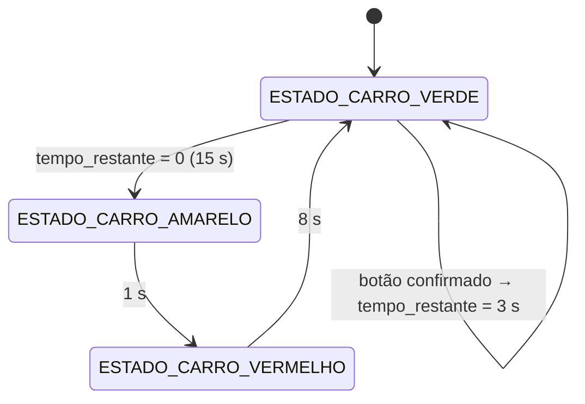

# Semáforo Inteligente Bare-Metal (ATmega328P / Arduino Uno)

Projeto de um semáforo de trânsito (veículos + pedestres) programado em no microcontrolador **ATmega328P**, sem usar as bibliotecas do framework Arduino. O projeto é compilado com **PlatformIO** e pode ser validado em simulação com a plataforma **SimulIDE** (arquivo `sim/simulation.sim1`).

[**Link do vídeo de demonstração**](https://youtube.com/shorts/JgIzdkicUE0)

---

## Estrutura do Projeto

```text
.
├── platformio.ini          # Configuração do PlatformIO (env ATmega328P)
├── src/
│   └── main.c              # Firmware bare-metal
├── sim/
│   ├── simulation.sim1     # Circuito do SimulIDE (ATmega328P + 5 LEDs + chave)
│   └── firmware.hex        # Firmware compilado, usado pela simulação
└── README.md
```

> O arquivo `sim/firmware.hex` é o `firmware.hex` pré-compilado pelo PlatformIO (em `.pio/build/ATmega328P/`), copiado para a pasta `sim/`.

---

## 📌 Mapeamento de Pinos e Hardware

| Elemento | Pino Arduino Uno | Porta / Pino MCU | Modo | Observação |
| :--- | :--- | :--- | :--- | :--- |
| **Carros Verde** | **Pino 8** | `PB0` | Saída | Resistor limitador (220 Ω na simulação) |
| **Carros Amarelo** | **Pino 9** | `PB1` | Saída | Resistor limitador (220 Ω na simulação) |
| **Carros Vermelho** | **Pino 10** | `PB2` | Saída | Resistor limitador (220 Ω na simulação) |
| **Pedestre Verde** | **Pino 11** | `PB3` | Saída | Resistor limitador (220 Ω na simulação) |
| **Pedestre Vermelho** | **Pino 12** | `PB4` | Saída | Resistor limitador (220 Ω na simulação) |
| **Botão de Pedestre** | **Pino 2** | `PD2` (`INT0`) | Entrada | **Pull-up interno ativado** (botão entre o pino e o GND) |

---

## ⚡ Conexões Elétricas

1. **Botão (push-button)**:
   - Um terminal no Pino 2 (PD2).
   - O outro terminal no GND.
   - Devido ao pull-up interno no pino `PD2`, não é necessário resistor externo.
2. **LEDs**:
   - Anodo (+) no respectivo pino do Arduino, em série com um resistor de 220 Ω.
   - Catodo (−) no GND comum.

---

## 🧠 Arquitetura Bare-Metal Implementada

### 1. GPIOs e Pull-up Interno
- **PORTB**: bits 0 a 4 como saída (`DDRB`) e iniciados em nível baixo (`PORTB`).
- **PORTD**: bit 2 como entrada (`DDRD &= ~(1 << PD2)`), com pull-up interno ativado (`PORTD |= (1 << PD2)`).

### 2. Temporização do Semáforo (Timer1, 1 s)
- Não há atrasos bloqueantes (`_delay_ms`) no fluxo de controle.
- O Timer1 (16 bits) opera em modo **CTC** com prescaler de **1024** e `OCR1A = 15624`:

  `f = 16.000.000 Hz / (1024 × (15624 + 1)) = 1 Hz` → uma interrupção `TIMER1_COMPA_vect` a cada **1 segundo**.
- A ISR decrementa `tempo_restante`; quando chega a zero, avança a FSM, recarrega o tempo do novo estado e sinaliza `atualizar_leds`.
- O `main()` apenas observa `atualizar_leds` e chama `rotina_leds()` para atualizar o `PORTB` (o resto do tempo fica ocioso, apto a usar modo *sleep*).

### 3. Botão de Pedestre (INT0 + debounce com Timer0)
O botão **não** dispara uma travessia imediata: ele **encurta o tempo restante do verde dos carros**.

1. **`INT0`** é configurada por borda de descida (`ISC01 = 1`, `ISC00 = 0`) e habilitada em `EIMSK`.
2. Na `ISR(INT0_vect)`: a própria `INT0` é desabilitada (ignora os *bounces*), o `TCNT0` é zerado e o **Timer0** é iniciado com prescaler 1024.
3. O Timer0 está em modo **CTC** com `OCR0A = 250`:

   `t = 1024 × (250 + 1) / 16.000.000 Hz ≈ 16 ms`
4. Na `ISR(TIMER0_COMPA_vect)`: o Timer0 é parado e o nível de `PD2` é relido. Se o botão **ainda estiver pressionado** (nível baixo) **e** o estado for `ESTADO_CARRO_VERDE` **e** `tempo_restante > TEMPO_CORTE_BOTAO`, então `tempo_restante = TEMPO_CORTE_BOTAO`.
5. Por fim, a flag `INTF0` é limpa (escrevendo `1` em `EIFR`, particularidade do AVR) e a `INT0` é reabilitada.

Como o Timer1 roda livre, o verde termina **entre 2 s e 3 s** após o aperto confirmado (`TEMPO_CORTE_BOTAO = 3`).

### 4. Máquina de Estados Finitos (FSM)



| Estado | LEDs acesos | Pinos | Duração padrão |
| :--- | :--- | :--- | :---: |
| `ESTADO_CARRO_VERDE` | Carro Verde + Pedestre Vermelho | `PB0` + `PB4` | 15 s |
| `ESTADO_CARRO_AMARELO` | Carro Amarelo + Pedestre Vermelho | `PB1` + `PB4` | 1 s |
| `ESTADO_CARRO_VERMELHO` | Carro Vermelho + Pedestre Verde | `PB2` + `PB3` | 8 s |

Ciclo completo sem acionamento do botão: **24 s**.

### 5. Parâmetros Configuráveis

Definidos no topo do `main.c` (valores em segundos):

| Macro | Valor | Descrição |
| :--- | :---: | :--- |
| `TEMPO_VERDE_CARROS` | 15 | Duração do verde dos carros |
| `TEMPO_AMARELO_CARROS` | 1 | Duração do amarelo dos carros |
| `TEMPO_VERMELHO_CARROS` | 8 | Duração do vermelho dos carros (verde do pedestre) |
| `TEMPO_CORTE_BOTAO` | 3 | Tempo restante de verde após o botão ser confirmado |

### 6. Comportamento e Limitações Atuais
- O botão só tem efeito durante o **verde dos carros** e se ainda restarem **mais de 3 s**; apertos durante o amarelo, o vermelho ou nos últimos 3 s do verde são ignorados (não há fila de pedidos).
- Não há estado de "todos vermelhos" nem pisca do LED vermelho do pedestre: o verde do pedestre acende junto com o vermelho dos carros e apaga na troca de estado.
- O amarelo de 1 s é curto para uso real; ajuste `TEMPO_AMARELO_CARROS` conforme necessário.

---

## Compilação com PlatformIO

Configuração do projeto (`platformio.ini`):

```ini
[env:ATmega328P]
platform = atmelavr
board = ATmega328P

upload_protocol = arduino
```

```bash
pio run                              # compila
pio run -t upload                    # grava na placa real
```

O binário é gerado em `.pio/build/ATmega328P/firmware.hex`. Para usá-lo na simulação, copia-se para a pasta `sim/`:

```bash
cp .pio/build/ATmega328P/firmware.hex sim/firmware.hex
```

---


## Simulação no SimulIDE

O arquivo **`sim/simulation.sim1`** contém o circuito completo, criado no **SimulIDE 1.1.0-SR2**. Ele fica na pasta `sim/`, junto do `firmware.hex` gerado pela compilação com o PlatformIO.

### Componentes do circuito

| Componente | Configuração |
| :--- | :--- |
| Microcontrolador | `mega328-16` (ATmega328P), **16 MHz**, reset/oscilador externo/watchdog desabilitados, programa `firmware.hex` (caminho relativo ao `.sim1`) |
| Resistores (×5) | 220 Ω, um em série com cada LED |
| Chave (`Switch-23`) | 1 polo, normalmente aberta, ligada entre `PORTD2` e o GND |
| Terra | GND comum para os LEDs e para a chave |

### Ligações

| Pino MCU | Resistor | LED (rótulo no SimulIDE) | Cor | Tensão de limiar |
| :---: | :---: | :--- | :--- | :---: |
| `PORTB0` | 220 Ω | `CARRO-VERDE` | Verde | 3,5 V |
| `PORTB1` | 220 Ω | `CARRO-AMARELO` | Amarelo | 2,4 V |
| `PORTB2` | 220 Ω | `CARRO-VERMELHO` | Vermelho | 1,8 V |
| `PORTB3` | 220 Ω | `PEDESTRE-VERDE` | Verde | 3,5 V |
| `PORTB4` | 220 Ω | `PEDESTRE-VERMELHO` | Vermelho | 1,8 V |
| `PORTD2` | — | Chave (botão de pedestre) → GND | — | — |

### Como executar
1. Compile o firmware com `pio run` e copie `.pio/build/ATmega328P/firmware.hex` para `sim/`.
2. Abra `sim/simulation.sim1` no SimulIDE. O microcontrolador referencia `firmware.hex` por caminho relativo, então o arquivo precisa estar na mesma pasta do `.sim1`.
   - Se o firmware não for carregado automaticamente (`Auto_Load` está desligado) ou se você recompilar, recarregue-o no chip (clique com o botão direito no microcontrolador → **Load firmware**).
3. Inicie a simulação. Os LEDs devem seguir a sequência da tabela de estados (15 s → 1 s → 8 s).

### Testando o botão de pedestre
A chave está ligada entre `PORTD2` e o GND; o pull-up interno do firmware mantém o pino em nível alto enquanto ela está aberta. Como o componente é uma **chave** (e não um push-button momentâneo), cada clique alterna entre aberta e fechada:

1. Durante o verde dos carros, com **mais de 3 s restantes**, **feche** a chave (borda de descida em `PD2`). Depois de ≈ 16 ms de debounce, o verde passa a durar mais 2 a 3 s.
2. **Abra** a chave de novo para poder gerar um novo aperto (a borda de subida é ignorada pelo firmware).
3. Fechar a chave durante o amarelo, o vermelho ou nos últimos 3 s do verde não tem efeito.